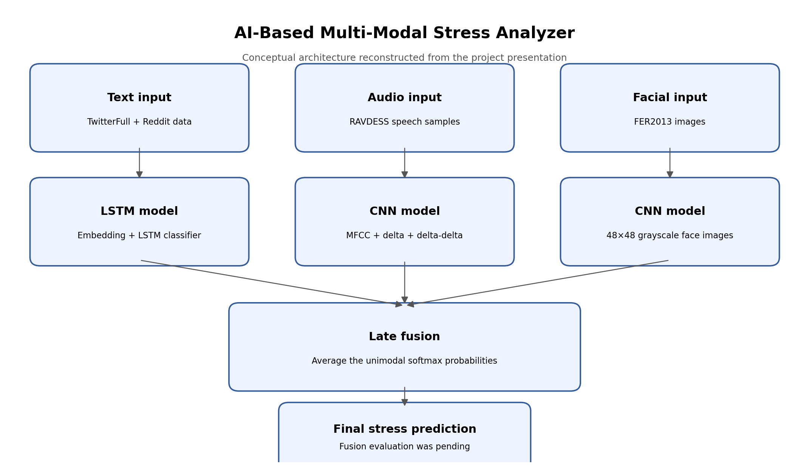

# AI-Based Multi-Modal Stress Analyzer

A university mini-project concept for analyzing stress-related signals across **text, speech, and facial expressions** using separate deep-learning models and a late-fusion strategy.

> **Project archive note:** The original implementation files and datasets are no longer available. This repository reconstructs the project documentation from the original presentation script. It is not a runnable reproduction of the original models.

## Project team
- Krish Raina
- Lakshaya Jandial
- Vikrant Mohan

**Faculty guide:** Dr. Deo Prakash  
**Department:** Computer Science and Engineering

## Objective
Explore whether combining linguistic, vocal, and facial-expression signals can provide a broader basis for stress-related classification than relying on a single modality.

## Architecture



Three independent model branches were described:
- **Text:** Embedding + LSTM using TwitterFull and Reddit text samples.
- **Audio:** CNN using MFCC, delta, and double-delta features extracted with Librosa from RAVDESS.
- **Face:** CNN using grayscale 48×48 images from FER2013.

The presentation describes a late-fusion stage that averages the models' softmax probability outputs.

## Datasets and reported individual-model results

| Modality | Dataset(s) | Model | Reported accuracy |
|---|---|---|---:|
| Text | TwitterFull and Reddit data | LSTM | 88% |
| Audio | RAVDESS | CNN | 44% |
| Face | FER2013 | CNN | 52% |

These figures are transcribed from the original project presentation. The original training code, exact data splits, class definitions, and evaluation logs are unavailable for independent verification.

## Technology stack
- Python
- TensorFlow / Keras
- OpenCV
- Librosa
- Google Colab (GPU training environment)

## Fusion status and limitations
The presentation describes **averaging softmax probabilities** as the late-fusion method. It also states that final fusion evaluation was pending because the three datasets were not aligned to the same samples. Simulated fusion tests were mentioned, but no verified final multimodal accuracy was reported.

Important limitations:
- The modalities were trained on separate datasets rather than a synchronized dataset containing text, audio, and facial data from the same stress events.
- The reported individual accuracies are not directly comparable unless label definitions, class balance, and evaluation protocols are aligned.
- The project should be treated as an academic prototype, not a clinically validated stress detector.
- The original model files, source code, and datasets are not included.

## Future work described in the presentation
1. Obtain or build a synchronized multimodal dataset.
2. Evaluate fusion on aligned samples and compare it against unimodal baselines.
3. Explore weighted fusion.
4. Develop a real-time webcam and microphone application.

## Repository contents
```text
ai-multimodal-stress-analyzer/
├── README.md
├── docs/
│   ├── methodology.md
│   ├── model-results.md
│   └── limitations-and-future-work.md
└── results/
    └── architecture.png
```

## Attribution and provenance
This documentation was reconstructed from the team's original presentation script. It preserves the reported approach and results while clearly marking details that cannot be independently checked because the original implementation has been lost.
